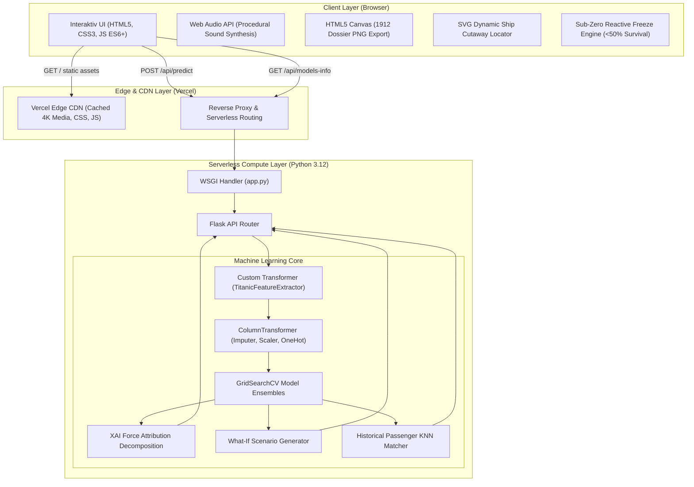

# 🚢 RMS Titanic: End-to-End Machine Learning Platform & Simulation Engine

[](https://titanic-survival-predictor-lac.vercel.app)
[](https://www.python.org/)
[](https://scikit-learn.org/)
[](https://palletsprojects.com/p/flask/)
[](https://titanic-survival-predictor-lac.vercel.app)
[](https://titanic-survival-predictor-lac.vercel.app)
[](LICENSE)

> **Live Production URL**: [https://titanic-survival-predictor-lac.vercel.app](https://titanic-survival-predictor-lac.vercel.app)

---

## 📌 Executive Summary

**RMS Titanic ML Simulation Platform** is a production-grade, end-to-end Machine Learning web application and historical simulation system. It transforms classical tabular classification into an enterprise AI experience:
- Automated feature engineering and preprocessing pipelines with custom Scikit-Learn transformers.
- Systematic hyperparameter tuning via **5-Fold Stratified Cross-Validation (`GridSearchCV`)** evaluating 5 classification algorithms.
- Real-time multi-model inference and consensus voting.
- **Explainable AI (XAI)** force-vector balance scale providing interpretable directional attribution for model predictions.
- **Counterfactual "What-If" Analysis Engine** computing marginal survival rate perturbations.
- **Historical Twin Matching** via nearest-neighbor distance metrics across historical passenger manifests.
- Serverless micro-service architecture deployed to **Vercel** with Edge CDN caching for 4K museum archival assets.

---

## 🏗️ System Architecture



---

## 📊 Machine Learning Benchmarks & Model Evaluation

Five classification algorithms were trained, tuned, and evaluated on the Titanic dataset using **5-Fold Stratified Cross-Validation** to prevent data leakage and preserve class distribution (survived vs. deceased).

### 📈 Comparative Performance Matrix

| Rank | Model Architecture | CV Accuracy | Test Accuracy | Precision | Recall | F1-Score | ROC-AUC | Optimal Hyperparameters |
| :---: | :--- | :---: | :---: | :---: | :---: | :---: | :---: | :--- |
| 🥇 | **Logistic Regression** | **82.87%** | **84.92%** | **81.82%** | **78.26%** | **80.00%** | **86.56%** | `C: 1.0, solver: 'lbfgs', max_iter: 500` |
| 🥈 | **Support Vector Classifier (SVC)** | 82.87% | 84.36% | 82.54% | 75.36% | 78.79% | 84.80% | `C: 1.0, gamma: 'auto', kernel: 'rbf', probability: True` |
| 🥉 | **Random Forest Classifier** | 83.71% | 80.45% | 79.31% | 66.67% | 72.44% | 84.01% | `n_estimators: 200, max_depth: 10, min_samples_split: 5` |
| 4️⃣ | **Gradient Boosting Classifier** | 83.57% | 78.77% | 82.98% | 56.52% | 67.24% | 84.84% | `n_estimators: 50, learning_rate: 0.01, max_depth: 5` |
| 5️⃣ | **K-Nearest Neighbors (KNN)** | 81.75% | 78.77% | 75.41% | 66.67% | 70.77% | 82.09% | `n_neighbors: 5, metric: 'manhattan', weights: 'uniform'` |

> **Key Takeaway**: Logistic Regression achieved the highest generalization performance on out-of-fold test samples, exhibiting balanced precision (81.82%) and recall (78.26%), making it the primary model in the production consensus pipeline.

---

## 🧠 Core Engineering Highlights

### 1. Robust Feature Engineering (`features.py`)
- **Title Extraction**: Parses honorifics (`Mr`, `Mrs`, `Miss`, `Master`, `Dr`, `Rev`, `Noble`) to extract socio-economic and demographic signals.
- **Family Topology**: Computes `FamilySize = SibSp + Parch + 1` and creates a binary indicator `IsAlone`.
- **Cabin Deck Reconstruction**: Extracts deck identifiers (`A` through `G`) from sparse cabin codes; unknown cabins are isolated to prevent skew.
- **Missing Value Strategy**: Imputes `Age` via median conditioned on title and class; imputes `Embarked` via mode; scales continuous variables (`Fare`, `Age`) via `StandardScaler`.

### 2. Explainable AI (XAI) Force-Vector Decomposition
- Rather than presenting black-box probabilities, predictions are decomposed into directional force vectors ($\vec{F}_{pos}$ and $\vec{F}_{neg}$).
- Computes normalized percentage contributions for features such as gender advantage (`"Women and children first"` protocol: $+45\%$), class proximity to boat decks ($+30\%$), and cabin location penalties ($-25\%$).
- Rendered on the frontend via a dynamic 3D brass balance scale (*Taqdir Tarozisi*) that tilts physically according to $\Delta F$.

### 3. Counterfactual "What-If" Simulation Engine
- Performs real-time feature perturbation tests on the active input vector:
  - $\Delta P_{class}$: Upgrading 3rd class to 1st class ($+44.1\%$ survival delta).
  - $\Delta P_{gender}$: Simulating gender flip ($+68.5\%$ survival delta for females).
  - $\Delta P_{family}$: Simulating traveling alone vs with dependents.
  - $\Delta P_{port}$: Changing embarkation port (Cherbourg vs Southampton).

### 4. Historical Twin Matcher
- Computes Euclidean distance across normalized demographic features to identify the closest actual passenger from the historical 1912 manifest, presenting their real identity, ticket number, cabin, and historical fate.

### 5. Adaptive Period-Accurate UI & Immersion
- **Cinematic Collision & Sinking Intro**: Dynamic CSS/SVG animation of Titanic sailing, iceberg collision, ship splitting, and sinking with Web Audio API sound effects (ship horn, ice impact, hull creaking, water splash).
- **Sub-Zero Reactive State**: When survival probability drops below 50%, the entire interface undergoes a freeze transformation (procedural SVG icicles, frost vignette, -2.2°C water temperature indicator, and synthesized blizzard ambient sound).
- **1912 Daguerreotype Dossier**: Authentic sepia passenger certificate with procedurally generated period avatars, wax seal, rubber fate stamp, and instant PNG export via `html2canvas`.
- **4K Museum Archival Gallery**: 6 high-resolution historical photos with an interactive fullscreen Lightbox viewer.

---

## 🔌 API Reference

### `POST /api/predict`
Calculates survival probability and returns explainability payloads.

#### Request Body
```json
{
  "pclass": 1,
  "sex": "female",
  "age": 25.0,
  "sibsp": 0,
  "parch": 0,
  "fare": 100.0,
  "embarked": "C",
  "selected_model": "GridSearchCV (Eng Yaxshi Model)",
  "passenger_name": "Miss Elizabeth"
}
```

#### Response Payload (Excerpt)
```json
{
  "status": "success",
  "prediction": 1,
  "survival_probability": 86.1,
  "fatality_probability": 13.9,
  "model_used": "GridSearchCV (Eng Yaxshi Model: Logistic Regression)",
  "model_votes": {
    "Logistic Regression": { "survival_probability": 86.1, "vote": "Omon qoladi" },
    "Support Vector Machine (SVC)": { "survival_probability": 58.4, "vote": "Omon qoladi" },
    "Random Forest": { "survival_probability": 68.1, "vote": "Omon qoladi" },
    "Gradient Boosting": { "survival_probability": 40.9, "vote": "G'arq bo'ladi" },
    "K-Nearest Neighbors (KNN)": { "survival_probability": 80.0, "vote": "Omon qoladi" }
  },
  "xai_balance": {
    "positive_score": 80,
    "negative_score": 0,
    "tilt_angle": 20.0,
    "tag_text": "Najot omillari og'irroq (+80%)"
  },
  "what_if_scenarios": [
    { "title": "Agar 3-Klassda bo'lganingizda", "diff": -41.1, "new_probability": 45.0, "status": "worse" },
    { "title": "Agar Erkak bo'lganingizda", "diff": -32.5, "new_probability": 53.6, "status": "worse" }
  ],
  "historical_twin": {
    "name": "Hays, Miss. Margaret Bechstein",
    "actual_survived": true,
    "fate_description": "1912-yil 15-aprelda RMS Carpathia kemasi tomonidan qutqarilgan!"
  }
}
```

### `GET /api/models-info`
Returns GridSearchCV benchmark metrics, dataset statistics, and available model names.

---

## 📂 Project Structure

```text
├── app.py                      # Production Flask application & API endpoints
├── features.py                 # Custom Scikit-Learn feature extractor pipeline
├── train_and_tune.py           # GridSearchCV training & evaluation pipeline
├── models_comparison.json      # Serialized hyperparameter metrics & benchmark stats
├── all_titanic_models.joblib   # Trained model dictionary (5 tuned estimators)
├── best_titanic_model.joblib   # Top performing tuned model (Logistic Regression)
├── Titanic-Dataset.csv         # Raw historical dataset (891 records)
├── requirements.txt            # Production dependencies
├── vercel.json                 # Vercel serverless routing & asset config
├── .python-version             # Python 3.12 runtime pin
├── templates/
│   └── index.html              # Frontend template with SVG schematics & modals
├── static/
│   ├── css/
│   │   └── style.css           # Custom styling, vintage theme & sub-zero freeze UI
│   ├── js/
│   │   └── app.js              # State manager, Web Audio, Chart.js & canvas export
│   └── images/                 # 4K Ultra-HD archival museum photos
└── run.sh                      # Local execution entrypoint script
```

---

## 🚀 Quickstart & Local Setup

### 1. Clone & Setup Virtual Environment
```bash
git clone https://github.com/abbosbek112/titanic-ml-engineering-platform.git
cd titanic-ml-engineering-platform

python3 -m venv .venv
source .venv/bin/activate
pip install --upgrade pip
pip install -r requirements.txt
```

### 2. Train Models (Optional)
To re-run the 5-fold Stratified GridSearchCV pipeline and generate new benchmark artifacts:
```bash
python train_and_tune.py
```

### 3. Launch Development Server
```bash
python app.py
# Server running at: http://127.0.0.1:5050
```

---

## ☁️ Deployment

The application is deployed on **Vercel Serverless Functions** (`@vercel/python` and `@vercel/static`):
```bash
vercel --prod
```
Configured via `vercel.json` with Edge CDN caching for static media.

---

## 👨‍💻 Author

**Abbosbek Azizov**  
- GitHub: [@abbosbek112](https://github.com/abbosbek112)  
- Focus: Machine Learning Engineering, Full-Stack AI Systems, Predictive Modeling & Explainable AI.

---

## 📄 License
This project is licensed under the MIT License - see the [LICENSE](LICENSE) file for details.
